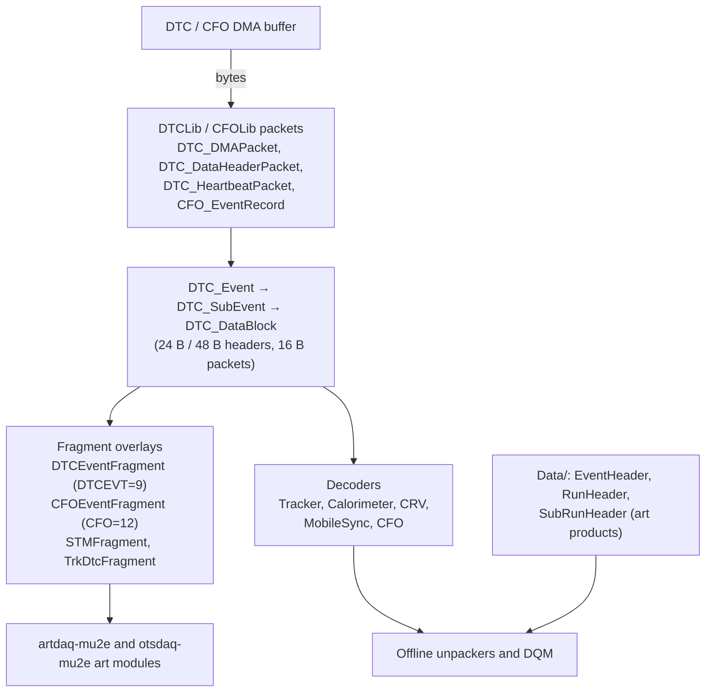

# artdaq-core-mu2e

> Mu2e artdaq fragment types, DTC and CFO packet overlays, subsystem payload decoders and art event-header data products, shared by the online DAQ and Offline

| | |
|---|---|
| Repository | `Mu2e/artdaq-core-mu2e` (superproject submodule URL: `normanajn/artdaq-core-mu2e`, a fork with issues disabled) |
| Language | C++17, cetmodules/CMake, ROOT dictionaries |
| Version | 9.02.00 at the superproject pin `cf86c07` (`CMakeLists.txt:13`); upstream `Mu2e/artdaq-core-mu2e` `develop` is 9.07.00, 68 commits ahead |
| Ports | none |
| Depends on | `artdaq-core` ≥ 3.09.00, TRACE, messagefacility, canvas (art), ROOT, Boost.Test (all external to this superproject) |
| Used by | `artdaq-mu2e`, `mu2e-pcie-utils`, every `otsdaq-mu2e*` art module, Mu2e Offline |

## Purpose

The code that must be identical online and offline: how the bytes a DTC or
CFO writes into a DMA buffer are typed, framed into artdaq Fragments, and
decoded. It is a library only — no executables, no services, no
configuration. Its interface is its headers; [INTERFACES.md](INTERFACES.md)
gives every layout field by field.

## Architecture

## Components

| Directory | Library | Role |
|---|---|---|
| `Overlays/FragmentType.hh` | `::Overlays` | the nine Mu2e Fragment type numbers (1, 5–12) and their names |
| `Overlays/DTC_Packets/`, `DTC_Types/` | `::Overlays` | 16-byte DTC packets (namespace `DTCLib`), event/sub-event containers, enums, exceptions |
| `Overlays/CFO_Packets/` | `::Overlays` | CFO event record and DMA packet copies (namespace `CFOLib`) |
| `Overlays/Decoders/` | `::Overlays` | per-subsystem payload decoders over a `DTC_SubEvent` |
| `Overlays/*Fragment.hh` | `::Overlays` | `artdaq::Fragment` overlay classes |
| `Overlays/Mu2e_fragmentNameHelper.cc` | plugin | `artdaq::FragmentNameHelper` registration (`cet_build_plugin`, `Overlays/CMakeLists.txt:44`) |
| `Data/` | `::Data` + dictionary | art Event/Run/SubRun header products |
| `BuildInfo/` | `_BuildInfo` | build-time stamp |

The `DTCLib` packet classes deliberately live here rather than in
`mu2e-pcie-utils`, so that Offline can decode raw data without the PCIe
driver library; `mu2e-pcie-utils` includes them for both its hardware path
and its `mu2esim` simulator.

## Interfaces

Headers only. Layouts, version fields, and the spec references
(Mu2e-doc-4914, Mu2e-doc-19095) are in [INTERFACES.md](INTERFACES.md).

## Configuration

None. Build switches are environment variables read by CMake: `USE_ASAN`,
`USE_TSAN`, `USE_UBSAN`, `USE_GCOV` (Debug builds, `CMakeLists.txt:28-53`),
`USE_EXCEPTIONSTACKTRACE` (`:57-65`) and `BUILD_ROOT_INTERFACE` (optional
`DTCLib` ROOT dictionary, `Overlays/CMakeLists.txt:50`).

## Operations

Nothing runs. Quality gates: two Boost.Test programs (`test/Overlays/DTC_Event_t.cc`,
`DTC_SubEvent_t.cc`; 8 test cases) parse good, short and long binary event
and sub-event files; nine GitHub workflows at the pin (eight upstream, which
dropped `auto_approve`) call the shared `Mu2e/.github`
reusable workflows (build, test, format, tidy, whitespace, build-against-develop)
plus issue/PR project tracking and an auto-approve. The build workflows'
`paths-ignore: docs/**` does not match this repository's `doc/`, so
documentation-only commits trigger full builds.

## Interactions with other packages

- `artdaq-mu2e` produces `DTCEVT` and `CFO` fragments with these classes and
  dumps/verifies them in art modules.
- `mu2e-pcie-utils` reads DMA buffers into `DTC_SubEvent`/`DTC_Event`
  (`dtcInterfaceLib/DTC.cpp:885,1224,2474`) and builds simulated packets with
  the pack functions (`dtcInterfaceLib/mu2esim.cpp`).
- `otsdaq-mu2e-{calorimeter,crv,tracker,trigger,dqm}` art modules include
  `DTCEventFragment.hh` and the decoders; `otsdaq-mu2e-tracker` also overlays
  `RocDataHeaderPacket_t`.
- `mu2edaq-dataformat-viewer` re-encodes the same layouts in YAML with no
  link to this code (see INTERFACES.md §11).

## Review findings

Six findings are staged in [ISSUES-PENDING.md](ISSUES-PENDING.md), each
re-checked against upstream `develop`:

- one S2: the subsystem ID does not round-trip through the packer;
- four S3: parsing has no buffer bound; bit-field layout and byte order are
  unchecked and there are no golden-byte tests; two headers share an include
  guard; the superproject pins a personal fork 68 commits behind upstream;
- one S4 header-hygiene rollup.

A fifth defect seen at the pin, the event and sub-event parsers looping
forever after a parse exception, is already fixed upstream (5225ef0,
8bf66e6). It is recorded as evidence that the pin is stale rather than filed
on its own.
